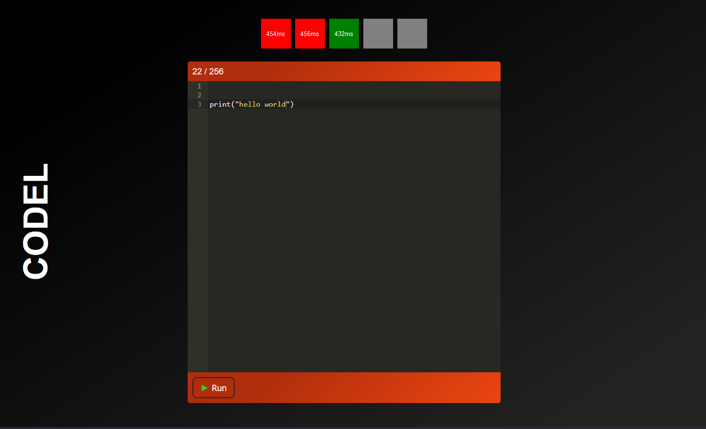

# Codel

Print “Hello World” in a mystery programming language. You get five guesses.



## Table of Contents

- [How to play](#how-to-play)
- [Run locally](#run-locally)
- [Technologies](#technologies)

## How to play

Enter a program that prints `Hello World`, then submit it. Codel sends your code to Piston for evaluation. Don't put secrets or private code in your guesses.

## Run locally

From the repository root, install dependencies with Poetry and start the web server:

```sh
poetry install
poetry run python webserver.py
```

Open `http://localhost:8787`. The server can start separately from the execution backend. The checked-in integration does not send the authorization now required by the public Piston endpoint, so a clean checkout is not a working end-to-end demo.

## Technologies

- [Flask](https://flask.palletsprojects.com/) and [Waitress](https://docs.pylonsproject.org/projects/waitress/en/stable/) serve the game.
- [Piston](https://github.com/engineer-man/piston) evaluates submitted code.
- [Twemoji](https://github.com/twitter/twemoji) and [SVG Spinners](https://github.com/n3r4zzurr0/svg-spinners) provide artwork and loading indicators.
